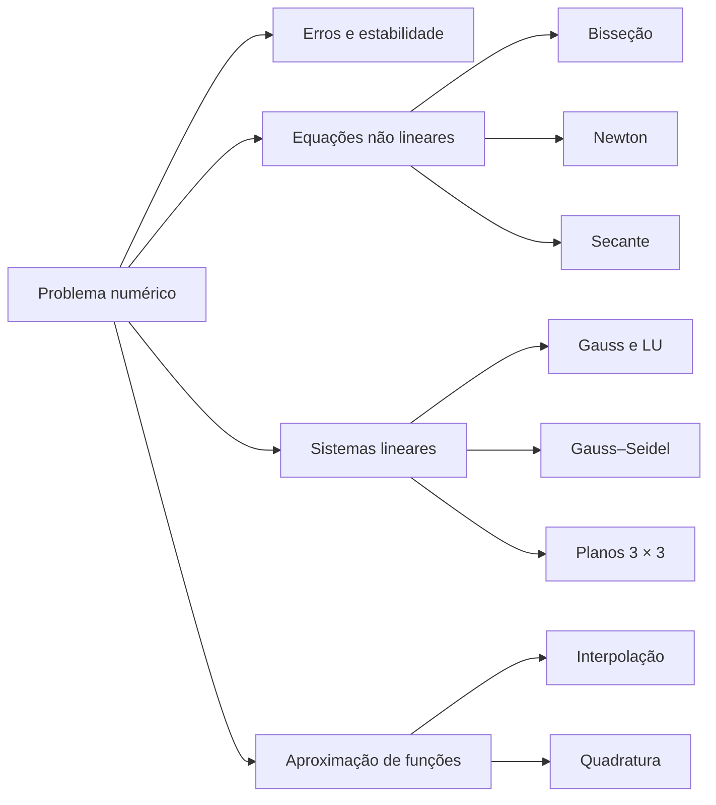

<div align="center">

# Cálculo Numérico

### Portfólio acadêmico de métodos, experimentos e aplicações computacionais

[](https://www.python.org/)
[](https://jupyter.org/)
[](https://numpy.org/)
[](#atividades)

**Responsável pelo repositório:** [Pedro Moreira](https://github.com/PedroMoreira191)<br>
**Disciplina:** Cálculo Numérico

</div>

Este repositório reúne atividades desenvolvidas em Python e Jupyter sobre erros numéricos, raízes de equações, sistemas lineares, interpolação e integração. Cada pasta contém uma leitura guiada do problema, a fundamentação matemática, os resultados comprovados e os arquivos necessários para estudar ou reproduzir o trabalho.

> [!NOTE]
> A ordem abaixo é didática e foi inferida do conteúdo e das datas dos materiais. Enunciados, versões históricas e resultados originais foram preservados e identificados explicitamente.

## Objetivos de aprendizagem

- reconhecer erros de representação, arredondamento, truncamento e cancelamento;
- analisar propagação de incertezas e estabilidade de algoritmos;
- implementar e comparar métodos iterativos para raízes e sistemas lineares;
- interpretar geometricamente sistemas de três equações;
- avaliar interpolação, extrapolação e integração numérica;
- comunicar hipóteses, critérios de parada, resultados e limitações com rigor.

## Atividades

| # | Atividade | Métodos e conceitos | Evidência principal |
|---:|---|---|---|
| 01 | [Fundamentos e erros computacionais](atividades/01_fundamentos_erros/) | erro absoluto/relativo, arredondamento, truncamento, cancelamento | notebook resolvido e exercícios |
| 02 | [Propagação de erros em peça circular](atividades/02_propagacao_erros_peca_circular/) | derivadas, propagação linear, análise por extremos | volume e tolerâncias de fabricação |
| 03 | [Biofluidodinâmica](atividades/03_biofluidodinamica/) | Hagen–Poiseuille, sensibilidade, ponto flutuante | quadro de resultados e GIF |
| 04 | [Estabilidade e overflow](atividades/04_estabilidade_overflow/) | Euler explícito, diferenças centrais, CFL difusivo | limites de passo e comparação `float32/64` |
| 05 | [Raízes de equações](atividades/05_raizes_equacoes/) | Bisseção, Newton e Secante | 12 experimentos, CSV e animações |
| 06 | [Sistemas lineares: Gauss e LU](atividades/06_sistemas_lineares_gauss_lu/) | pivoteamento, substituições, fatoração LU | notebook, quadro e animação |
| 07 | [Sistemas lineares: planos 3 × 3](atividades/07_sistemas_lineares_planos/) | postos, compatibilidade e interpretação geométrica | notebook interativo e prévia HTML |
| 08 | [Gauss–Seidel](atividades/08_gauss_seidel/) | dominância diagonal e iteração estacionária | notebook, resolução manuscrita e gráfico |
| 09 | [Interpolação polinomial](atividades/09_interpolacao_polinomial/) | Lagrange, ajuste, extrapolação e fenômeno de Runge | dois estudos computacionais |
| 10 | [Integração numérica](atividades/10_integracao_numerica/) | Ponto Médio, Trapézios, Simpson e Richardson | notebook com estudos de convergência |

## Mapa dos métodos



## Síntese matemática

| Tema | Relação central | Leitura |
|---|---|---|
| Erro relativo | $E_r=\frac{\lvert x-\tilde{x}\rvert}{\lvert x\rvert}$ | compara o erro à escala do valor exato |
| Propagação | $\Delta f\approx\sum_i\left|\frac{\partial f}{\partial x_i}\right|\Delta x_i$ | estima a influência das incertezas de entrada |
| Bisseção | $c_k=(a_k+b_k)/2$ | robusta quando há mudança de sinal |
| Newton | $x_{k+1}=x_k-f(x_k)/f'(x_k)$ | rápida perto de uma raiz, sensível ao chute e à derivada |
| Gauss–Seidel | $x_i^{(k+1)}=\frac{1}{a_{ii}}\left(b_i-\sum_{j<i}a_{ij}x_j^{(k+1)}-\sum_{j>i}a_{ij}x_j^{(k)}\right)$ | atualiza componentes assim que ficam disponíveis |
| Simpson 1/3 | $\int_a^b f(x)\,dx\approx\frac{h}{3}[f_0+4f_1+2f_2+\cdots+f_n]$ | quadratura composta de ordem quatro sob hipóteses usuais |

## Ferramentas

- Python 3, NumPy e pandas para cálculos e tabelas;
- Matplotlib e Pillow para gráficos e animações;
- Jupyter/Google Colab para relatórios executáveis;
- `unittest` e `pytest` para validação automatizada;
- Markdown, Mermaid e LaTeX para documentação.

## Como reproduzir

```bash
python3 -m venv .venv
source .venv/bin/activate
python3 -m pip install -r requirements.txt
jupyter lab
```

Abra o notebook da atividade desejada e execute as células em ordem. Algumas entregas também possuem scripts e testes próprios; os comandos exatos estão no README de cada pasta.

Para validar o portfólio:

```bash
python3 -m unittest discover -s tests -q
python3 -m unittest discover -s atividades/06_sistemas_lineares_gauss_lu -p 'test_*.py' -q
python3 -m unittest discover -s atividades/07_sistemas_lineares_planos -p 'test_*.py' -q
python3 -m pytest atividades/05_raizes_equacoes/projeto/tests -q
```

## Estrutura

```text
CN/
├── README.md
├── requirements.txt
├── atividades/        # dez entradas documentadas e numeradas
├── docs/              # auditoria, decisões e planos de implementação
└── tests/             # validações de estrutura e links do portfólio
```

## Limitações conhecidas

- os notebooks preservam saídas históricas; nem todas foram regeneradas no mesmo ambiente;
- a atividade de interpolação polinomial local não possui saídas executadas salvas;
- a tabela salva no notebook de integração não acompanha a última versão do código;
- links externos de Colab/Mathcha não são necessários para a reprodução local e não são tratados como evidência de acesso público;
- versões antigas podem conter identificação acadêmica de colaboradores; ela foi preservada nos originais, mas não repetida nesta página.

Consulte a [auditoria técnica](docs/auditoria_tecnica.md) para testes, decisões de preservação e pendências verificadas.
