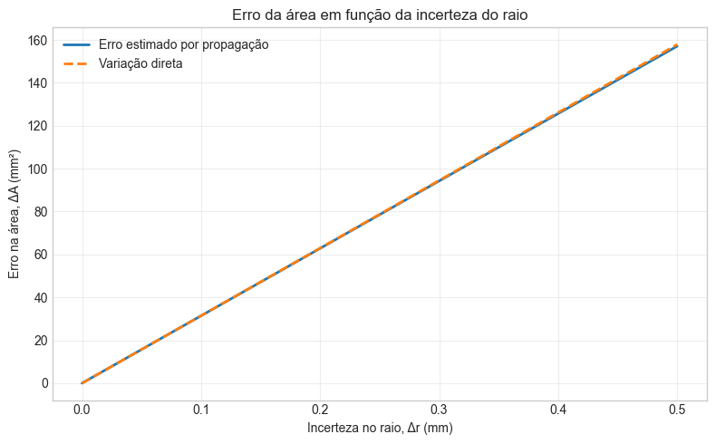

# 02 · Propagação de erros em uma peça circular

## Objetivo

Avaliar como as tolerâncias do raio $r$ e da espessura $h$ afetam diâmetro, perímetro, área e volume de uma peça cilíndrica, relacionando o resultado à escolha do processo de fabricação.

## Modelo matemático

$$D=2r,\qquad P=2\pi r,\qquad A=\pi r^2,\qquad V=\pi r^2h.$$

A propagação linear de pior caso usa

$$\Delta f\approx\left|\frac{\partial f}{\partial r}\right|\Delta r+
\left|\frac{\partial f}{\partial h}\right|\Delta h.$$

O notebook compara essa aproximação com a avaliação direta nos extremos das tolerâncias.

## Dados e resultados

Para $r=50\,\text{mm}$, $h=10\,\text{mm}$, $\Delta r=0{,}05\,\text{mm}$ e $\Delta h=0{,}02\,\text{mm}$:

| Grandeza | Erro relativo estimado |
|---|---:|
| Diâmetro | 0,10% |
| Perímetro | 0,10% |
| Área | 0,20% |
| Volume | 0,40% |

O volume nominal é `78.539,8163 mm³`, com incerteza linear de `314,1593 mm³`. Os cenários de fabricação estudados produzem erros de volume de aproximadamente 3,20%, 0,70% e 0,14%.



## Arquivos

- [`solucao.ipynb`](solucao.ipynb) — análise computacional, tabelas e gráficos;
- [`enunciado.pdf`](enunciado.pdf) — enunciado original preservado.

## Execução

```bash
jupyter lab atividades/02_propagacao_erros_peca_circular/solucao.ipynb
```

## Conclusão

Grandezas com potências maiores amplificam as incertezas dimensionais. A análise fornece um critério quantitativo para comparar processos de fabricação.

