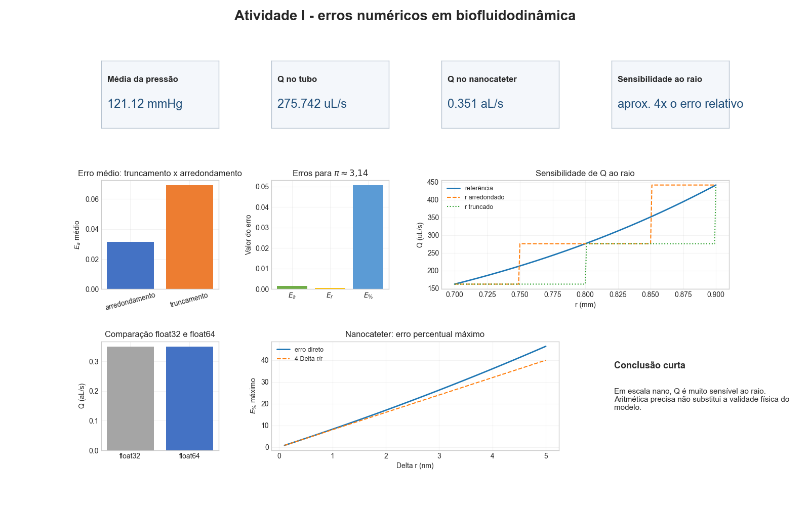

# 03 · Erros numéricos em biofluidodinâmica

## Objetivo

Investigar arredondamento, truncamento, precisão de ponto flutuante e sensibilidade paramétrica em medições de pressão e no escoamento de fluidos em tubos e nanocateteres.

## Fundamentação

A vazão de Hagen–Poiseuille é

$$Q=\frac{\pi\,\Delta P\,r^4}{8\mu L}.$$

Como $Q\propto r^4$, uma pequena incerteza relativa no raio é amplificada aproximadamente por um fator quatro:

$$\frac{\Delta Q}{Q}\approx 4\frac{\Delta r}{r}.$$

## Resultados confirmados

- média de referência da pressão: `121,12 mmHg`;
- média após arredondamento: `121,10 mmHg`; após truncamento: `120,70 mmHg`;
- vazão nominal do tubo: $2{,}757421\times10^{-7}\,\text{m}^3/\text{s}$;
- vazão nominal do nanocateter: $3{,}506242\times10^{-19}\,\text{m}^3/\text{s}$;
- diferença relativa observada entre cálculos `float32` e `float64`: cerca de $1{,}49\times10^{-7}$.



## Arquivos

- [`entrega.ipynb`](entrega.ipynb) — versão principal, da qual procedem as figuras;
- [`versao_complementar.ipynb`](versao_complementar.ipynb) — resolução alternativa preservada;
- [`versao_publicada_original.ipynb`](versao_publicada_original.ipynb) — versão histórica recuperada do GitHub;
- [`enunciado.pdf`](enunciado.pdf) — enunciado corrigido;
- [`figuras/nanocateter_vazao_raio.gif`](figuras/nanocateter_vazao_raio.gif) — animação da sensibilidade ao raio.

## Execução

Execute apenas uma versão por vez; as versões históricas usam nomes de saída iguais.

```bash
jupyter lab atividades/03_biofluidodinamica/entrega.ipynb
```

## Discussão

O termo $r^4$ domina a sensibilidade: medir o raio corretamente é mais importante que aumentar casas decimais em parâmetros menos influentes. A comparação de precisões mostra ainda que o tipo numérico faz parte do modelo computacional.

