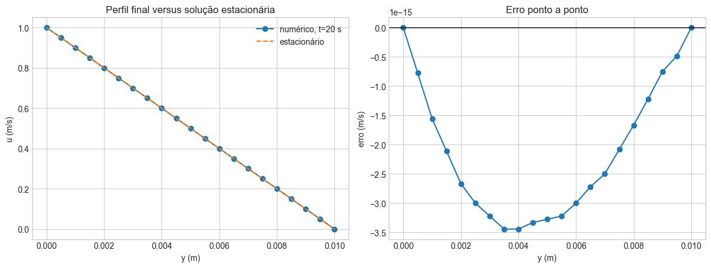

# 04 · Estabilidade e overflow

## Objetivo

Estudar estabilidade, refinamento de malha e overflow na solução explícita do escoamento transiente de Couette.

## Método numérico

Com Euler explícito no tempo e diferenças centrais no espaço:

$$u_i^{n+1}=u_i^n+r\left(u_{i+1}^n-2u_i^n+u_{i-1}^n\right),
\qquad r=\frac{\nu\Delta t}{\Delta y^2}.$$

A condição de estabilidade é

$$r\leq\frac12\quad\Longrightarrow\quad
\Delta t\leq\frac{\Delta y^2}{2\nu}.$$

## Resultados confirmados

| Malha | Limite de $\Delta t$ | Casos discutidos |
|---|---:|---|
| 21 pontos | `0,00125 s` | $r=0{,}4$ estável; $r=0{,}8$ instável |
| 41 pontos | `0,0003125 s` | $r=1{,}6$ versus $r=0{,}16$ |

No caso instável, o perfil sai da faixa física no terceiro passo. O overflow aparece no passo 121 com `float32` e no passo 917 com `float64`. Para `t=20 s`, o caso estável aproxima o perfil estacionário com erro máximo salvo de $3{,}4417\times10^{-15}\,\text{m/s}$.



## Arquivos

- [`solucao.ipynb`](solucao.ipynb) — versão local documentada;
- [`versao_publicada_original.ipynb`](versao_publicada_original.ipynb) — versão histórica do GitHub.

## Execução

```bash
jupyter lab atividades/04_estabilidade_overflow/solucao.ipynb
```

## Conclusão

Refinar a malha espacial melhora resolução, mas reduz quadraticamente o passo de tempo permitido. Maior precisão de ponto flutuante adia o overflow; não corrige uma discretização instável.

