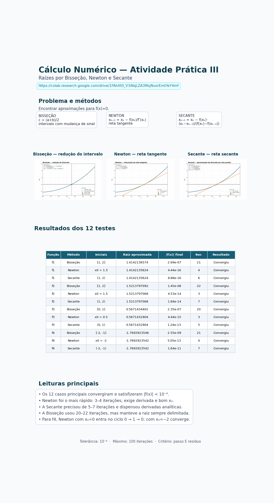

# 05 · Raízes por Bisseção, Newton e Secante

## Objetivo

Comparar robustez, velocidade e dependência das condições iniciais em três métodos para resolver $f(x)=0$.

## Métodos

$$\text{Bisseção: }c_k=\frac{a_k+b_k}{2}$$

$$\text{Newton: }x_{k+1}=x_k-\frac{f(x_k)}{f'(x_k)}$$

$$\text{Secante: }x_{k+1}=x_k-f(x_k)\frac{x_k-x_{k-1}}{f(x_k)-f(x_{k-1})}$$

O critério implementado exige simultaneamente passo e resíduo menores que $10^{-6}$, com no máximo 100 iterações.

## Resultados

Os 12 casos principais convergiram. Newton usou 3–4 iterações, a Secante 5–7 e a Bisseção 20–22. As quatro raízes estudadas são aproximadamente:

`1,4142135624`, `1,5213797068`, `0,5671432904` e `−1,7692923542`.

Newton aplicado a $f_4(x)=x^3-2x+2$ com $x_0=0$ produz o ciclo $0\leftrightarrow1$, exemplo de como um método rápido pode falhar por causa do chute inicial.



## Arquivos

- [`projeto/atividade_calculo_numerico.ipynb`](projeto/atividade_calculo_numerico.ipynb) — relatório executável;
- [`projeto/resultados.csv`](projeto/resultados.csv) — resultados completos;
- [`projeto/gifs/`](projeto/gifs/) — animações dos três métodos;
- [`projeto/README.md`](projeto/README.md) — detalhes técnicos e reprodução;
- [`projeto/GUIA_MATHCHA.md`](projeto/GUIA_MATHCHA.md) — guia da composição visual.

## Execução e testes

```bash
jupyter lab atividades/05_raizes_equacoes/projeto/atividade_calculo_numerico.ipynb
python3 -m unittest discover -s atividades/05_raizes_equacoes/projeto/tests -q
```

O notebook versionado já contém as saídas verificadas. O script `build_notebook.py`
é destinado à manutenção: ele reconstrói o arquivo sem saídas e deve ser seguido
por uma execução integral antes de substituir a entrega. Os testes podem regenerar
CSV e imagens; revise o `git diff` após executá-los.

