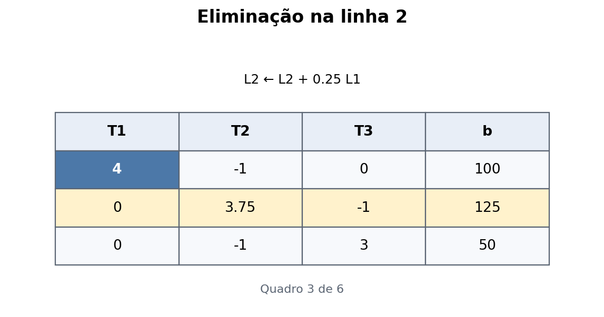

# 06 · Sistemas lineares: eliminação de Gauss e fatoração LU

## Objetivo

Resolver sistemas $A\mathbf{x}=\mathbf{b}$ por métodos diretos, visualizar as operações elementares e verificar numericamente a solução pelo resíduo.

## Métodos

Na eliminação de Gauss, múltiplos de uma linha-pivô são subtraídos das linhas inferiores até obter um sistema triangular. O pivoteamento parcial troca linhas para reduzir o risco de divisão por pivôs pequenos. Na fatoração LU,

$$A=LU,\qquad L\mathbf{y}=\mathbf{b},\qquad U\mathbf{x}=\mathbf{y}.$$

Substituições progressiva e regressiva completam os dois procedimentos.

## Resultados confirmados

- sistema térmico: $[35{,}365854,\ 41{,}463415,\ 30{,}487805]$;
- exemplo clássico da animação: $[2,\ 3,\ -1]$;
- o notebook registra resíduo nulo, dentro da precisão utilizada, no exemplo térmico.



## Arquivos

- [`solucao.ipynb`](solucao.ipynb) — explicação, código e animação embutida;
- [`preview.html`](preview.html) — leitura estática exportada;
- [`figuras/eliminacao_gauss.gif`](figuras/eliminacao_gauss.gif) — animação externa do exemplo clássico;
- [`preparar_notebook.py`](preparar_notebook.py), [`executar_notebook.py`](executar_notebook.py) e [`gerar_gif.py`](gerar_gif.py) — ferramentas de reprodução;
- `test_notebook.py` e `test_gif.py` — validações automatizadas.

## Execução e testes

```bash
jupyter lab atividades/06_sistemas_lineares_gauss_lu/solucao.ipynb
python3 -m unittest discover -s atividades/06_sistemas_lineares_gauss_lu -p 'test_*.py' -q
```

## Conclusão

Os métodos diretos produzem a solução em um número finito de etapas em aritmética exata. Pivoteamento e verificação do resíduo são essenciais para transformar o procedimento algébrico em um algoritmo confiável.

