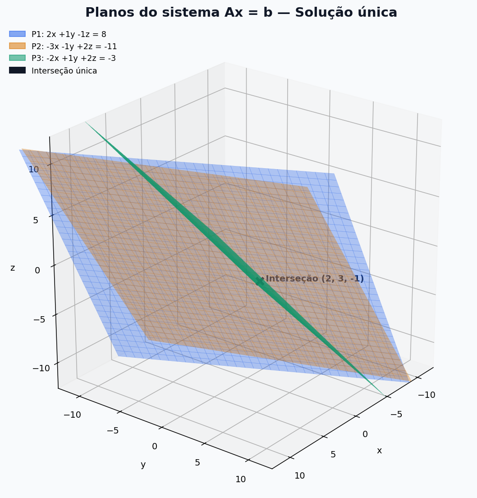

# 07 · Sistemas lineares como planos em $\mathbb{R}^3$

## Objetivo

Relacionar a classificação algébrica de um sistema $3\times3$ à geometria de três planos e permitir a edição interativa dos coeficientes.

## Fundamentação

Para a matriz aumentada $[A\mid\mathbf b]$:

- $\operatorname{posto}(A)<\operatorname{posto}([A\mid\mathbf b])$: sistema incompatível;
- $\operatorname{posto}(A)=\operatorname{posto}([A\mid\mathbf b])<3$: infinitas soluções;
- $\operatorname{posto}(A)=3$: solução única.

O classificador usa uma tolerância relativa para o posto de $A$ e verifica a consistência pelo resíduo de mínimos quadrados. Assim, multiplicar todas as equações por um mesmo fator não muda a resposta.

## Exemplo principal

$$
\begin{cases}
2x+y-z=8\\
-3x-y+2z=-11\\
-2x+y+2z=-3
\end{cases}
$$

A interseção única é $(2,3,-1)$ e a norma do resíduo salva é aproximadamente $1{,}776\times10^{-15}$.



## Arquivos

- [`planos_interativo.ipynb`](planos_interativo.ipynb) — notebook com visualização e `ipywidgets`;
- [`preview.html`](preview.html) — prévia estática;
- [`construir_notebook.py`](construir_notebook.py) — gerador reprodutível;
- [`test_planos.py`](test_planos.py) — testes de classificação, malha, figura e invariância à escala.

## Execução e testes

```bash
jupyter lab atividades/07_sistemas_lineares_planos/planos_interativo.ipynb
python3 -m unittest discover -s atividades/07_sistemas_lineares_planos -p 'test_*.py' -q
```

> [!NOTE]
> O HTML mostra o resultado salvo. Para editar os 12 parâmetros e redesenhar os planos, execute o notebook em Jupyter ou Colab.

