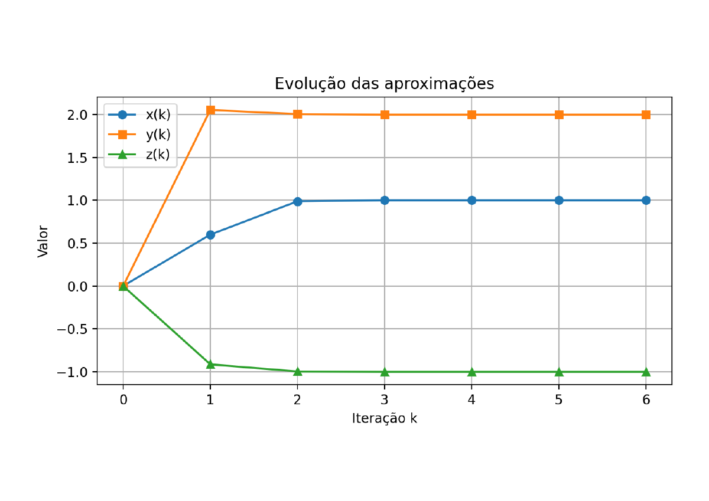

# 08 · Método de Gauss–Seidel

## Objetivo

Aplicar um método iterativo a um sistema linear, verificar uma condição suficiente de convergência e acompanhar o erro entre iterações.

## Método

Para $A\mathbf{x}=\mathbf b$, cada componente é atualizado usando imediatamente os valores novos já calculados:

$$x_i^{(k+1)}=\frac{1}{a_{ii}}
\left(b_i-\sum_{j<i}a_{ij}x_j^{(k+1)}-\sum_{j>i}a_{ij}x_j^{(k)}\right).$$

O exercício usa

$$A=\begin{bmatrix}10&-1&2\\-1&11&-1\\2&-1&10\end{bmatrix},
\qquad \mathbf b=\begin{bmatrix}6\\22\\-10\end{bmatrix},$$

matriz estritamente diagonal dominante.

## Resultados

Partindo de $\mathbf{x}^{(0)}=(0,0,0)$, as iterações convergem para $(1,2,-1)$. O cálculo independente para as saídas registradas fornece

$$\|\mathbf{x}^{(6)}-\mathbf{x}^{(5)}\|_\infty\approx1{,}2626\times10^{-6}.$$



## Arquivos

- [`gauss_seidel.ipynb`](gauss_seidel.ipynb) — implementação e gráficos recuperados do repositório;
- [`resolucao_completa.pdf`](resolucao_completa.pdf) — quatro páginas com desenvolvimento manuscrito e gráficos;
- [`resolucao_compacta.pdf`](resolucao_compacta.pdf) — versão compactada histórica.

## Execução

```bash
jupyter lab atividades/08_gauss_seidel/gauss_seidel.ipynb
```

## Conclusão

A dominância diagonal fornece uma condição suficiente de convergência para este exemplo. O gráfico do erro confirma a redução progressiva da diferença entre iteradas.

