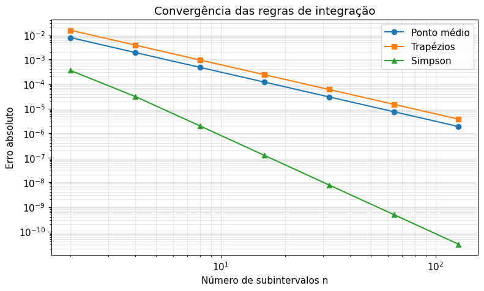

# 10 · Integração numérica

## Objetivo

Implementar regras compostas de quadratura, comparar ordens de convergência e usar refinamento/Richardson para estimar o erro.

## Métodos

Para uma partição uniforme de passo $h$:

- **Ponto Médio:** soma $h\,f$ nos centros dos subintervalos;
- **Trapézios:** usa aproximações lineares por subintervalo;
- **Simpson 1/3:** combina pesos $1,4,2,\ldots,4,1$ e exige número par de subintervalos.

Sob hipóteses usuais, Ponto Médio e Trapézios têm erro global de ordem $O(h^2)$, enquanto Simpson tem ordem $O(h^4)$.

## Resultados confirmados

- referência para $\int_0^1e^{-x^2}\,dx$: `0,746824132812`;
- Simpson integra exatamente o polinômio cúbico do exemplo em $[0,2]$, produzindo `4`;
- integração de dados sintéticos por Trapézios: deslocamento `8,45 m`;
- atividades guiadas: integrais exatas `2` e `0,75`;
- com `n=16`, erros de Simpson de aproximadamente $1{,}6591\times10^{-5}$ e $1{,}2258\times10^{-6}$.



## Arquivo

- [`solucao.ipynb`](solucao.ipynb) — teoria, implementações, tabelas e estudos de convergência.

## Execução

```bash
jupyter lab atividades/10_integracao_numerica/solucao.ipynb
```

> [!NOTE]
> A saída salva da tabela guiada é anterior ao código atual, e a célula final de gráficos não possui saída. Execute todas as células em ordem para obter uma apresentação consistente.

## Conclusão

As experiências confirmam as ordens teóricas e mostram como refinamento e extrapolação de Richardson ajudam a avaliar precisão sem depender de uma integral exata conhecida.

